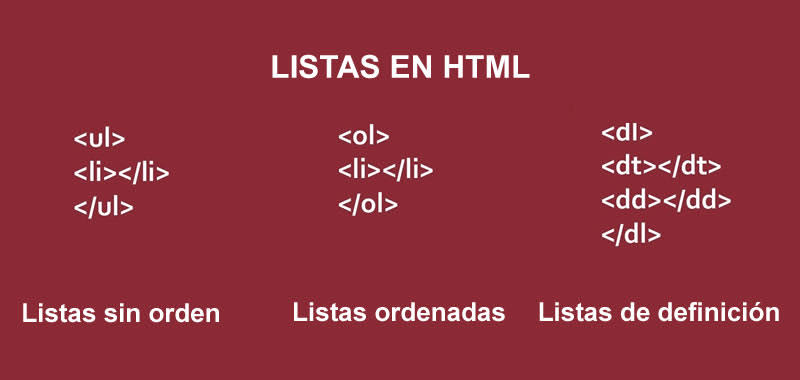

# Estructura HTML ES

## Básica
El principio esencial del lenguaje HTML es el uso de las etiquetas. Funcionan así:
- `<xxx>` Este es el inicio de una etiqueta
- `</xxx>` Este es el cierre de una etiqueta

Lo que haya entre ambas etiquetas estará afectado por ellas. Por ejemplo, todo el documento HTML debe estar entre las etiquetas `<HTML>` y `</HTML>`

Un documento HTML en sí está dividido en dos zonas principales:
- La cabecera, comprendida entre las etiquetas `<HTML>` y `</HTML>`
- El cuerpo, comprendido entre las etiquetas `<BODY>` y `</BODY>`

Dentro de la cabecera hay información del documento, que no se ve en la pantalla principal del navegador que es utilizado para visualizar el documento HTML, principalmente la información encontrada en la cabecera es el título del documento, comprendido entre las etiquetas `<TITTLE>` y `</TITTLE>`.

Dentro del cuerpo está todo lo que queremos que aparezca como el texto, imágenes, etc.

Por tanto, la estructura queda así:

`<HTML>`
    `<HEAD>`
        `<TITTLE>` Título de la página `</TTITLE>`
    `</HEAD>`
    `<BODY>`
        Aquí van las etiquetas que visualizan la página
    `</BODY>`
`</HTML>`

## Enlaces
Lo más importante de los documentos HTML son los enlaces. Ya que mediante los enlaces en HTML podemos comunicar una página con otra. De esta forma, enlazando documentos HTML podemos acabar tejiendo lo que es Internet.

Los enlaces generalmente tienen la siguiente estructura:
`<a href="destine_enlace">texto_enlace</a>`

Pero existen distintos tipos de enlaces:

- Enlaces para direcciones de correo
También podemos añadir enlaces de direcciones de correo
`<a href="mailto:direccion de e-mail"> Texto del enlace </a>`

- Enlaces para descargar fichero:
Otro de los usos que se les da a los enlaces en HTML es el de habilitar la descarga de ficheros. En este caso el destino indicado por el atributo href debe de ser el fichero que queremos descargar. En estos casos es bueno que el fichero a descargar este comprimido.

`<a href="fichero.zip">Descargar el fichero</a>`
Es importante que sepas que el navegador siempre va a intentar abrir el fichero enlazado en el atributo href para poder mostrarlo visualmente. En el caso de que no encuentre ningún programa para abrirlo nos mostrará un menú emergente en el que nos dará la posibilidad de guardar el fichero.

- Enlaces para imágenes:
Sólo hemos visto enlaces en HTML cuyo contenido era texto. Si bien como contenido de los enlaces podemos poner imágenes.

``
De esta forma toda la imagen será

## Imágenes
La estructura de la etiqueta para incluir imagenes es:
``
Para poner una imagen en una página web, usamos el elemento ``. Se trata de un elemento vacío (es decir, no puede tener contenido secundario ni etiqueta de cierre) que requiere dos atributos para ser útil: src y alt. El atributo src contiene una URL que apunta a la imagen que quieres incrustar en la página. Al igual que con el atributo href de los elementos `<a>`, el atributo src puede ser una URL relativa o una URL absoluta. Sin un atributo src, un elemento img no tiene ninguna imagen que cargar.

## Fondos y colores
Se puede cambiar el fondo de dos maneras:
- Con color
- Con una imagen

**-Fondos con color**
Se consigue añadiendo BGCOLOR a la etiqueta `<body>`(al principio del documento), de esta manera:
`<body bgcolor="#XXYYZZ>`

**-Fondos con una imagen**
El fondo de una página puede ser también una imagen, ya sea formato JPG o GIF. La imagen se repetiria por toda la página. La estructura sería:
`<body background="imagen.gif/jpg">`

## Listas

A menudo nos interesará presentar las cosas en forma de listas. Podemos escoger entre tres tipos distintos:
- Listas desordenadas (no numeradas).
- Listas ordenadas (numeradas).
- Listas de definición.

Las listas desordenadas sirven para presentar cosas que, por no tener un orden determinado, no necesitan ir precedidas por un número. Su estructura es la siguiente:

**`<UL>`**

        **<LI>** Un elemento
        **<LI>** Otro elemento
        **<LI>** Otro más
        **<LI>** etc.
**`</UL>`**

Es decir, toda la lista está dentro de la etiqueta **`<UL>`** y **`</UL>`**, y luego cada elemento va precedida de la etiqueta **`<LI>`**. Se puede anidar una lista dentro de otra. Por ejemplo:

**`<UL>`**

        <LI> Mamíferos
        <LI> Peces
        <UL>
            <LI> Sardina
            <LI> Bacalao
        </UL>
        <LI> Aves
**`</UL>`**

Las listas ordenadas sirven para presentar elementos en un orden determinado. Su estructura es similar a la anterior. La diferencia estriba en que aparecerá automáticamente un número correlativo para cada elemento.

**`<OL>`**

        <LI> Primer elemento
        <LI> Segundo elemento
        <LI> Tercer elemento
        <LI> etc.
**`</UL>`**

El tercer elemento son las listas de definiciones. Se utilizan para hacer glosarios. Toda la lista debe ir englobada entre las etiquetas **`<DL>`** y **`</DL>`**. La diferencia que encontramos es que cada reglón de la lista tiene dos partes:

    <DL>
        <DT> Una cosa a definir
            <DD> La definición de esta cosa
    <DT> Otra cosa a definir
        <DD> La definición de esta otra cosa
    </DL>
[1]
## Fuentes Bibliográficas
1: https://www.uv.es/jbosch/PDF/Curso%20de%20HTML.pdf
Webgrafía:

https://www.uv.es/jbosch/PDF/Curso%20de%20HTML.pdf [1]

https://www.manualweb.net/html/enlaces-html/ [2]