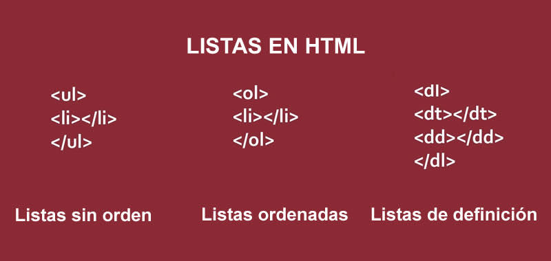

# Listas

A menudo nos interesará presentar las cosas en forma de listas. Podemos escoger entre tres tipos distintos:
- Listas desordenadas (no numeradas).
- Listas ordenadas (numeradas).
- Listas de definición.

Las listas desordenadas sirven para presentar cosas que, por no tener un orden determinado, no necesitan ir precedidas por un número. Su estructura es la siguiente:

**`<UL>`**

        **<LI>** Un elemento
        **<LI>** Otro elemento
        **<LI>** Otro más
        **<LI>** etc.
**`</UL>`**

Es decir, toda la lista está dentro de la etiqueta **`<UL>`** y **`</UL>`**, y luego cada elemento va precedida de la etiqueta **`<LI>`**. Se puede anidar una lista dentro de otra. Por ejemplo:

**`<UL>`**

        <LI> Mamíferos
        <LI> Peces
        <UL>
            <LI> Sardina
            <LI> Bacalao
        </UL>
        <LI> Aves
**`</UL>`**

Las listas ordenadas sirven para presentar elementos en un orden determinado. Su estructura es similar a la anterior. La diferencia estriba en que aparecerá automáticamente un número correlativo para cada elemento.

**`<OL>`**

        <LI> Primer elemento
        <LI> Segundo elemento
        <LI> Tercer elemento
        <LI> etc.
**`</UL>`**

El tercer elemento son las listas de definiciones. Se utilizan para hacer glosarios. Toda la lista debe ir englobada entre las etiquetas **`<DL>`** y **`</DL>`**. La diferencia que encontramos es que cada reglón de la lista tiene dos partes:

    <DL>
        <DT> Una cosa a definir
            <DD> La definición de esta cosa
    <DT> Otra cosa a definir
        <DD> La definición de esta otra cosa
    </DL>
[1]
## Fuentes Bibliográficas
1: https://www.uv.es/jbosch/PDF/Curso%20de%20HTML.pdf